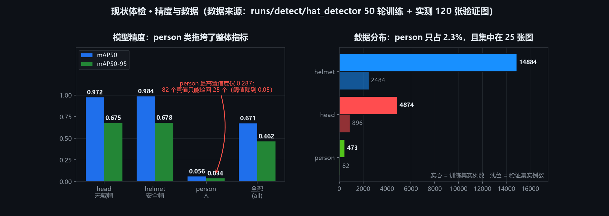
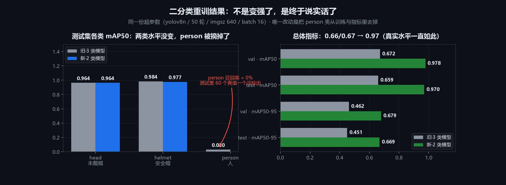
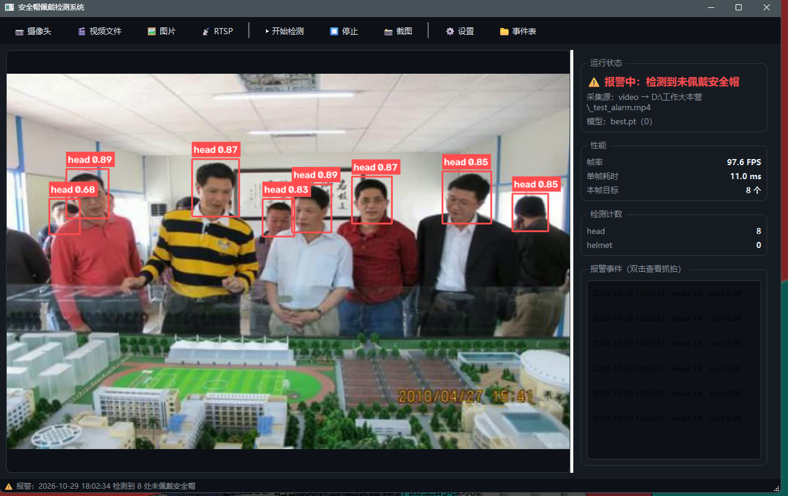

# 安全帽佩戴检测系统（hat_detector）

基于 YOLOv8 的安全帽佩戴检测：识别画面中的 **未戴安全帽的头部（head）** 与 **安全帽（helmet）**，
提供网页端（上传图片 / 浏览器摄像头）与本地 OpenCV 实时窗口两种使用方式。



## 指标

当前模型是 **head / helmet 二分类**（`yolov8n` 微调 50 轮，`imgsz=640`，`batch=16`，耗时约 1.6 小时，RTX 4060 Laptop 8GB）：

| 类别 | 训练集实例 | Precision | Recall | mAP50 | mAP50-95 |
| --- | --- | --- | --- | --- | --- |
| head（未戴安全帽） | 4874 | 0.9304 | 0.9554 | **0.9709** | 0.6764 |
| helmet（安全帽） | 14884 | 0.9642 | 0.9428 | **0.9842** | 0.6823 |
| **总体** | 19758 | 0.9473 | 0.9491 | **0.9775** | 0.6793 |

*（val 集 883 张 / 3380 个实例）*

**测试集**（883 张 / 3286 个实例）：head 0.9637 / helmet 0.9765 / **总体 mAP50 0.9701**（mAP50-95 0.6692），
与 val 只差 **0.74 个百分点**，泛化正常。



> 📄 完整对比（含被替换掉的旧 3 类模型）见 [docs/report_2cls.md](docs/report_2cls.md)。
>
> **为什么不是 3 类（head / helmet / person）**：person 全集只有 615 个实例（占 2.3%），
> 旧模型在测试集上对它的**召回率是 0**（60 个真值一个都没检出），把总体 mAP50 从 0.977 拉到 0.66。
> 而 head / helmet 两类的水平重训前后没变——去 person 不是为了变强，而是为了让指标说实话。
> 告警逻辑本来就只看 `head`，二分类才是这个项目该有的形态。

## 环境要求

- Windows / Linux，Python 3.10+
- 已验证组合：Windows 11 · Python 3.12.10 · ultralytics 8.4.142 · torch 2.6.0+cu124 · gradio 6.26.0 · opencv-python 5.0.0.93 · RTX 4060 Laptop 8GB
- 无 GPU 也能跑（CPU 推理，速度较慢）

## 安装

```bash
# 1) 创建虚拟环境（可选，推荐）
python -m venv venv
venv\Scripts\activate          # Windows
# source venv/bin/activate     # Linux / macOS

# 2) 装依赖（CPU 或按 ultralytics 默认选择 torch）
pip install -r requirements.txt

# 需要 GPU 训练时，先装 CUDA 版 torch，再装其余
pip install -r requirements-train.txt
pip install -r requirements.txt
```

## 数据准备

数据集体积约 259MB，**不随仓库提供**（含第三方数据许可限制）。请按下面的结构放置：

```
data/dataset/
├─ images/{train,val,test}/   # 图片
└─ labels/{train,val,test}/   # 与图片同名的 .txt 标注
```

`data.yaml` 是 3 类配置（head / helmet / person），`data2cls.yaml` 是当前使用的二分类配置。
放好数据后先体检一次：

```bash
python scripts/check_dataset.py                      # 体检 3 类数据集
python scripts/check_dataset.py --data data2cls.yaml # 体检二分类数据集
```

体检内容：图片/标注配对、类别分布、坐标是否越界、框宽高是否为 0、类别 id 是否越界、
图片能否解码、尺寸是否过小、是否有重复图片、train/val 是否混入同一张图。

### 派生二分类数据集

只有 3 类数据集时，一条命令就能派生出 head/helmet 二分类版本（图片走硬链接，不额外占磁盘）：

```bash
python scripts/make_2class.py              # 生成 data/dataset_2cls/ + data2cls.yaml
python scripts/make_2class.py --copy       # 改为复制图片
python scripts/make_2class.py --keep head  # 只保留某一类
```

## 训练

实验目录自动带时间戳（`runs/detect/<名称>_<YYYYmmdd_HHMMSS>/`），**不会覆盖历史结果**：

```bash
python train.py --data data2cls.yaml --name hat_2cls   # 当前推荐：二分类
python train.py                                        # 用 data.yaml 训练 3 类
python train.py --epochs 100 --cache ram               # 多轮 + 图片缓存提速
python train.py --model yolov11n.pt --cos-lr           # 换模型 / 余弦退火学习率
python train.py --data coco8.yaml --no-check           # 官方小数据集先跑通流程
```

## 评估

```bash
python evaluate.py --split val                                # 验证集（自动取最新的 best.pt）
python evaluate.py --split test                               # 测试集
python evaluate.py --data data2cls.yaml --split test --json runs/eval_test.json
python evaluate.py --model runs/detect/xxx/weights/best.pt    # 指定模型
```

输出分类指标表（Precision / Recall / mAP50 / mAP50-95），`--json` 可落盘。

## 使用

### 桌面程序（推荐）



```bash
python desktop.py                    # 打开界面，再点按钮选采集源
python desktop.py --source 0         # 直接开摄像头 0 并自动开始检测
python desktop.py --source demo.mp4  # 直接播视频文件
python desktop.py --source photo.jpg # 检测单张图片
python desktop.py --source rtsp://192.168.1.10:554/stream
```

功能：

- 四种采集源：**摄像头 / 视频文件 / 图片 / RTSP 流**；
- 实时画面上叠加检测框（head 红框 = 未戴安全帽，helmet 蓝框 = 已佩戴）；
- 右栏显示运行状态、帧率、单帧耗时、本帧目标数、各类计数；
- **报警闭环**：连续 N 帧确认（默认 3 帧，去掉单帧误报）→ 状态变红 + 声音提示 + 自动抓拍 + 事件写入 CSV；
- 报警事件列表**双击即可打开对应抓拍**；
- 「截图」保存当前帧，「事件表」直接定位到 `captures/events.csv`；
- 「设置」里调模型路径、置信度阈值、报警灵敏度、抓拍目录，写回 `configs/default.yaml`；
- 快捷键：`F5` 开始、`F6` 停止、`Ctrl+S` 截图。

报警产物默认存在 `captures/`（已在 .gitignore 中忽略）：

```
captures/
├─ 20261029_180229_001.jpg   # 报警时的抓拍
├─ ...
└─ events.csv                # 事件表：时间 / 类别 / 置信度 / 数量 / 抓拍路径
```

### 无界面模式

```bash
python cli.py --type image --source photo.jpg          # 单张图片
python cli.py --type video --source demo.mp4 --frames 200
python cli.py --type camera --source 0 --show          # --show 弹 OpenCV 窗口
python cli.py --type rtsp  --source rtsp://192.168.1.10/stream
python cli.py --type image --source photo.jpg --no-sound   # 报警不发声
```

### 网页版（远程查看）

```bash
python app.py                                  # 默认 http://127.0.0.1:7860
APP_PORT=8080 python app.py                     # 换端口
```

- 「图片检测」页：上传图片 → 点「开始检测」→ 出带框结果与分类统计；
- 「实时检测」页：先点「▶ 开始检测」再授权摄像头；「⏹ 停止检测」后只回显画面、不再占 GPU；
- 局域网访问：`server_name` 已设为 `0.0.0.0`，用 `http://<本机IP>:7860` 即可。**但浏览器摄像头只在 `http://127.0.0.1` 下可用**，局域网设备请用「图片检测」。

> 实时检测链路约 5 FPS：瓶颈不是模型（GPU 单帧仅 7.4ms / 135 FPS），
> 而是浏览器摄像头 → WebSocket → 服务端 → 回传图片这一来一回的传输开销（`stream_every=0.2`）。
> 想要真正的实时体验，用下面的本地窗口模式。

### 本地实时窗口

```bash
python demo_opencv.py                                   # 默认摄像头 0
python demo_opencv.py --source video.mp4 --tracker       # 视频 + ByteTrack 追踪
python demo_opencv.py --conf 0.3 --imgsz 416             # 调阈值与推理分辨率
python demo_opencv.py --source 0 --device cpu            # 强制 CPU
```

窗口内按键：`q` 退出、`s` 保存当前帧、空格暂停/继续。

```bash
python demo.py --source photo.jpg --save    # 单张图片检测并保存
python demo.py --source 0 --conf 0.5        # 轻量版实时检测
```

## 部署与打包（免 Python 环境）

模型可以导出成 ONNX，再用 PyInstaller 打成单目录 exe，别人**双击就能用**，不用装 Python / CUDA / torch。

```bash
# 1) 导出 ONNX（best.pt -> best.onnx，约 12MB）
python scripts/export.py

# 2) 对比两个后端：确认结果一致、速度可接受（要分开进程跑，见下方提示）
python scripts/benchmark_backends.py --only torch
python scripts/benchmark_backends.py --only onnx
python scripts/benchmark_backends.py              # 两后端一致性对比

# 3) 打包（Windows）
powershell -ExecutionPolicy Bypass -File packaging\build.ps1
# 产物：dist\hat_detector\hat_detector.exe —— 整个文件夹拷给别人即可
```

**两个推理后端**（设置里的 `backend`：`auto` / `torch` / `onnx`）：

| 后端 | 依赖 | imgsz 640 | imgsz 320 | 用途 |
| --- | --- | --- | --- | --- |
| torch | ultralytics + PyTorch（约 2.5GB） | 19.0ms（GPU，52 FPS） | — | 开发机有显卡时最快 |
| **onnx** | onnxruntime（约 38MB） | **23.9ms（CPU，42 FPS）** | **7.7ms（CPU，129 FPS）** | 打包后的 exe 用它 |

两后端检测一致率 **98.5% ~ 100%**（IoU≥0.5 且同类别算匹配），可以放心切换。

> ⚠️ 测速注意：torch 与 onnxruntime 各有自己的线程池，**放进同一个进程会互相抢 CPU**——
> 实测同进程跑会把 onnx 的 24ms 拉到 225ms。请用 `--only` 分别开进程测。

**打包产物实测**：`dist/hat_detector/` 共 **265.4 MB**，冷启动到出窗口 **0.11 秒**，运行时占用约 228MB 内存。

> 原计划压到 120MB，实际做不到：OpenCV 的 `cv2.pyd` 是单体文件 **82MB**，视频解码库再占 **29MB**，
> 光这两项就 111MB。已裁掉 PyInstaller 自动带进来的无用 Qt 组件（软件 OpenGL 回退、Qt6Quick/Qml/Pdf 等，共 39.2MB）。
> 想再瘦只能牺牲能力：去掉 ffmpeg 库（-29MB，但 mp4/RTSP 就打不开了）。
> 相比之下，**原来要 2.5GB 的 Python + torch 环境，现在 265MB 单目录双击即用**。

## 目录结构

```
hat_detector/
├─ desktop.py             # ★ 桌面程序入口（PySide6）
├─ cli.py                 # ★ 无界面模式（给无显示器机器 / 脚本调用）
├─ core/                  # ★ 纯逻辑层，不依赖 Qt
│  ├─ paths.py            #   打包后路径解析（只读资源 vs 可写数据）
│  ├─ config.py           #   配置读写（configs/default.yaml）
│  ├─ detector.py         #   模型加载与推理（torch / onnx 双后端）、画框
│  ├─ sources.py          #   摄像头 / 视频 / 图片 / RTSP 统一采集接口
│  ├─ pipeline.py         #   采集 + 推理双线程管道（丢旧帧保证实时）
│  ├─ postprocess.py      #   跨类别去重、分类计数
│  └─ alarm.py            #   报警去抖 + 抓拍 + 声音 + 事件 CSV
├─ ui/                    # ★ PySide6 界面层
│  ├─ main_window.py      #   主窗口（工具栏 / 画面 / 信息栏 / 状态栏）
│  ├─ video_view.py       #   等比缩放的视频控件
│  ├─ side_panel.py       #   状态、性能、计数、事件列表
│  └─ settings_dialog.py  #   设置面板
├─ app.py                 # Gradio 网页版（图片检测 + 浏览器摄像头实时检测）
├─ demo.py                # 轻量命令行/实时演示（超简单版）
├─ demo_opencv.py         # OpenCV 实时窗口（异步读帧 + FPS/HUD + 连续帧报警）
├─ train.py               # YOLOv8 微调训练（实验目录带时间戳，不覆盖历史结果）
├─ evaluate.py            # val / test 指标评估，可落盘 JSON
├─ data.yaml              # 3 类数据集配置（head / helmet / person）
├─ data2cls.yaml          # 二分类数据集配置（head / helmet，当前使用）
├─ models/                # 打包用的 ONNX 模型（不入库）
├─ scripts/
│  ├─ check_dataset.py    # 数据集体检
│  ├─ make_2class.py      # 从 3 类派生二分类数据集
│  ├─ export.py           # best.pt -> best.onnx
│  └─ benchmark_backends.py  # torch / onnx 速度与一致性对比
├─ packaging/
│  └─ build.ps1           # PyInstaller 打包脚本（含裁剪无用 Qt 组件）
├─ docs/
│  ├─ report_2cls.md      # 二分类重训对比报告
│  └─ images/             # README 与报告用图
├─ requirements.txt        # 运行依赖（含 PySide6、onnxruntime）
├─ requirements-train.txt  # 训练 / GPU 依赖
├─ requirements-deploy.txt # 导出 ONNX + 打包依赖
├─ data/                  # 数据集（不入库）
├─ captures/              # 报警抓拍与事件表（不入库）
└─ runs/                  # 训练与评估产物、模型权重（不入库）
```

## 常见问题

**Q：模型文件在哪？**
每次训练会在 `runs/detect/<名称>_<时间戳>/weights/best.pt` 生成一份（约 6.2MB，3.0M 参数）。
仓库不提供权重，需自行训练；`evaluate.py` 不指定 `--model` 时会自动取最新的那份。

**Q：报 `找不到训练好的模型`？**
先 `python train.py --data data2cls.yaml --name hat_2cls` 完成训练。

**Q：torch 报 CUDA 不可用？**
说明装的是 CPU 版 torch：`pip uninstall torch torchvision` 后按 `requirements-train.txt` 安装 CUDA 版。

**Q：网页版摄像头黑屏？**
必须是 `http://127.0.0.1:7860` 访问（浏览器只允许安全上下文使用摄像头），且不能同时被其他程序占用。

## 已知限制

- 网页版实时链路约 5 FPS（桌面版本地检测约 40~100 FPS）；
- 打包产物 265MB，主要被 OpenCV 的单体 `cv2.pyd`（82MB）和视频解码库（29MB）占住；
- 多路摄像头、ROI 危险区域、按跟踪去重还没做。

## 优化路线

1. ✅ **模型**（已完成）：head/helmet 二分类重训、测试集接入评估、训练脚本带时间戳实验目录 —— 见 [docs/report_2cls.md](docs/report_2cls.md)；
2. ✅ **桌面程序**（已完成）：PySide6 界面 + `core` 纯逻辑层（采集 / 推理双线程），支持摄像头、视频、图片、RTSP，报警闭环（连续帧去抖 + 声音 + 抓拍 + CSV 事件），设置面板写回 `configs/default.yaml`；
3. ✅ **部署**（已完成）：best.pt → ONNX，torch / onnx 双后端（一致率 98.5%+），PyInstaller 单目录 exe **265MB、冷启动 0.11 秒、免 Python 环境**；
4. **增强**：ROI 区域、ByteTrack 去重、多路摄像头、事件导出 Excel。

## 数据与致谢

- 检测框架：[Ultralytics YOLOv8](https://github.com/ultralytics/ultralytics)（AGPL-3.0）
- 数据集：Hard Hat Workers 系列（Roboflow 导出，3 类标注）。使用/分发前请确认原始数据集的许可条款。
