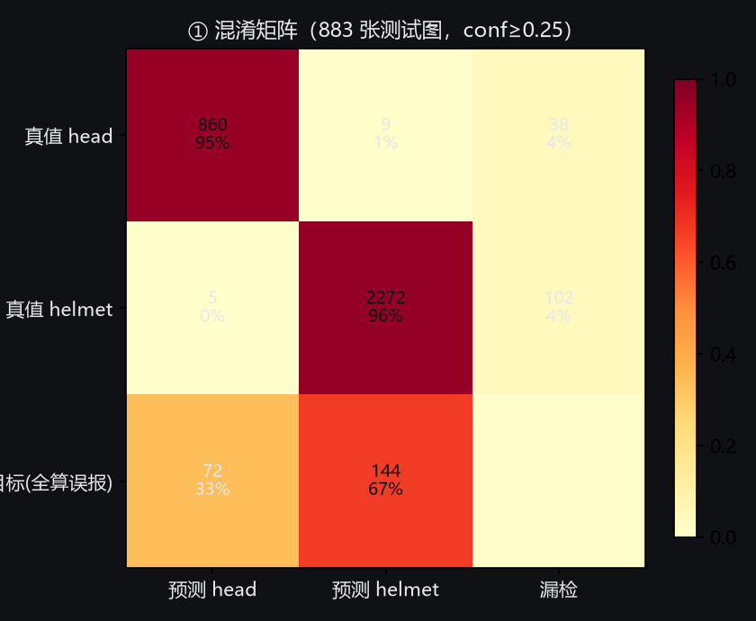
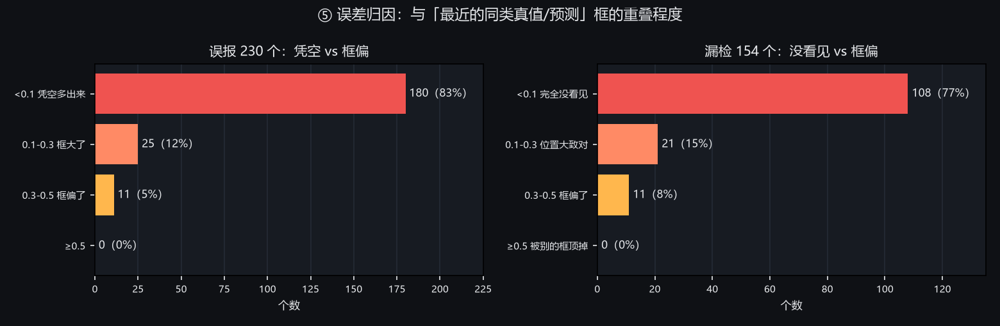
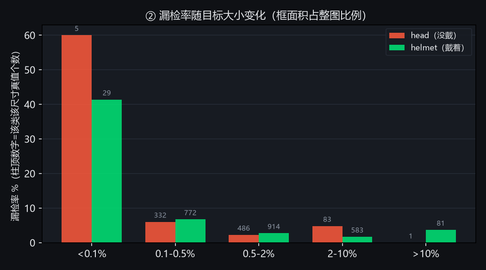
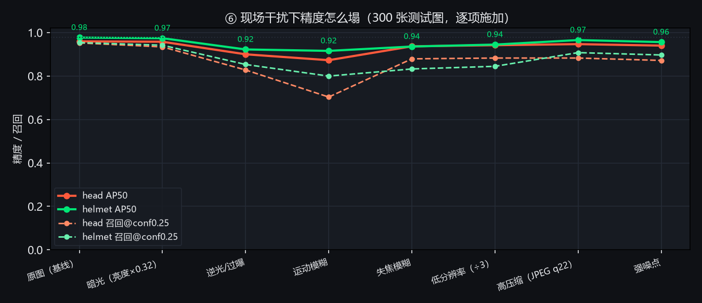
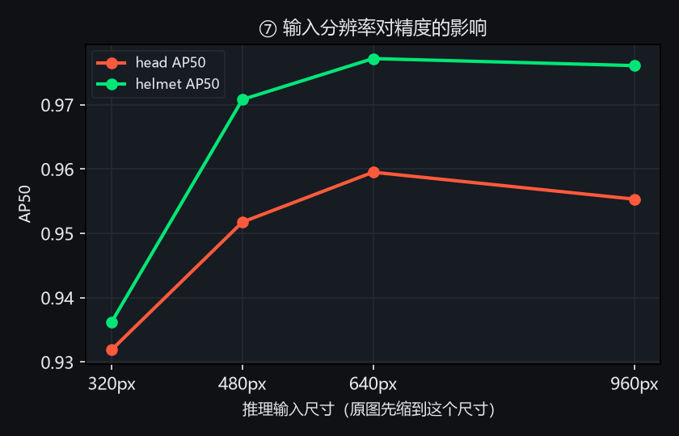
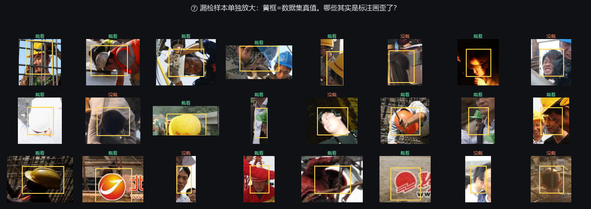

# 识别错误优化路线（阶段 5 → 9）

> 日期：2026-11-01　｜　分析对象：`runs/detect/hat_2cls_20261029_085425/weights/best.pt`
> 分析方法：`scripts/error_analysis.py`（逐框拆错）+ `scripts/robustness_check.py`（人为施加现场干扰）+ `scripts/fn_label_check.py`（漏检单独放大）
> 数据：`runs/error_analysis_data2cls_test/error_stats.json`、`runs/robustness/report.json`，图在 `docs/analysis/`

---

## 0. 先给结论

**模型在它的训练数据上已经没什么可挖的了，你现场觉得错得多，错不在「模型不会」，在「它没见过你的场景」。**

三句话概括证据：

1. 测试集 mAP50 0.9701、框级精确率 0.918/0.937 —— 继续在旧数据上调参、换损失、刷 epoch，预期收益**不到 1 个百分点**。
2. 错误归因显示：误报里 **83% 是「凭空多框出来的」**，漏检里 **77% 是「根本没看见」**。也就是说不是框画歪了、也不是被 NMS 压掉了，是模型**看错了内容**。这类错，调阈值调不动（误报的置信度横跨 0.25~0.9 全区间）。
3. 一旦给图片加上真实摄像头会遇到的干扰，精度立刻塌：**运动模糊让 head 召回从 0.95 掉到 0.70（-25pp）**，逆光/过曝掉 12pp。你的场景大概率比测试图更暗、更抖、目标更小。

所以路线的主线只有一条：**把「你的场景」变成训练数据**，再谈模型和后处理。

---

## 1. 现在的错误长什么样

### 1.1 混淆矩阵：跨类错判几乎不存在，错的是「有/没有」



|  | 数量 | 说明 |
| --- | --- | --- |
| 真值 head 被正确检出 | 860 / 907（95%） | |
| 真值 helmet 被正确检出 | 2272 / 2379（96%） | |
| **head ↔ helmet 互相认错** | 9 + 5 = **14** | 只占 3286 个真值的 0.4%，**不是主要矛盾** |
| 漏检（真值没被任何框覆盖） | 140 | |
| 误报（框没对上任何真值） | 216 | |

883 张测试图里有 241 张（27%）至少错一个框。框级：head 精确率 0.918 / 召回 0.948，helmet 0.937 / 0.955。

**结论**：二分类的语义边界（帽子 vs 头）模型学得挺清楚，"戴没戴"分得开；错在"这东西到底是不是头/帽"。

### 1.2 误差归因：不是框画不准，是没看见



- 误报 230 个中 **180 个（83%）与同类真值的重叠 <0.1** —— 凭空多出来的，不是"框偏了一点"。
- 漏检 154 个中 **108 个（77%）与最近预测框重叠 <0.1** —— 完全没看见，不是被别的框顶掉（被顶掉的是 0 个）。

技术含义：**后处理、NMS、置信度阈值的优化空间很小**，别在这上面花太多时间；要提分只能改模型能看到的东西（数据、分辨率、时序）。

### 1.3 目标越小越容易漏



| 框占整图面积 | head 漏检率 | helmet 漏检率 |
| --- | --- | --- |
| < 0.1% | 60%（3/5） | **41%（12/29）** |
| 0.1–0.5% | 6.0% | 6.7% |
| 0.5–2% | 2.3% | 2.7% |
| > 2% | ~4% | ~1.5% |

这是一个**断崖**：0.1% 以下的目标，四个里漏一个半。你的摄像头在 720p/1080p 下、人离镜头 3 米以上时，头部框正好落在这个区间。安慰的是 0.1–2% 这一段召回就有 93–97%，说明只要人别太远，模型够用。

画面人数的影响反而很小（1-2 人 vs 6 人以上，漏检率差不到 3pp），说明**不是"人多了顾不上"，是"看不清"**。

### 1.4 现场干扰：运动模糊最致命



对 300 张测试图逐项施加干扰（其余条件不变），AP50 / 召回@conf0.25：

| 干扰 | head AP50 | helmet AP50 | head 召回 | helmet 召回 |
| --- | --- | --- | --- | --- |
| 原图（基线） | 0.960 | 0.977 | 0.952 | 0.954 |
| 暗光（亮度×0.32） | 0.958 | 0.974 | 0.934 | 0.942 |
| 逆光 / 过曝 | 0.900 | 0.922 | 0.828 | **0.853** |
| **运动模糊（1×9 水平拖影）** | **0.873** | **0.916** | **0.703** | **0.800** |
| 失焦模糊（高斯 9） | 0.937 | 0.936 | 0.879 | 0.833 |
| 低分辨率（÷3 再放大） | 0.942 | 0.945 | 0.883 | 0.845 |
| 高压缩（JPEG q22） | 0.947 | 0.966 | 0.883 | 0.908 |
| 强噪点 | 0.940 | 0.956 | 0.872 | 0.897 |

读法：
- **运动模糊一巴掌拍掉 25 个百分点召回**，过曝掉 12pp，失焦/低分辨率掉 7–11pp。摄像头抖动、人走动、逆光窗边，就是你现场"错很多"的物理来源。
- 暗光几乎不掉，是因为这批测试图本身很亮，压到 0.32 仍然清楚；**这说明不了暗光没问题**，只是没测到 —— 你现场若是晚上/背光房间，这条要单独验。
- 训练集里没有这些退化，模型没学过"糊了也要认出来"。

### 1.5 输入分辨率：640 是甜点，别再降



| 推理尺寸 | head AP50 | helmet AP50 |
| --- | --- | --- |
| 320 | 0.932 | 0.936 |
| 480 | 0.952 | 0.971 |
| **640** | **0.960** | **0.977** |
| 960 | 0.955 | 0.976 |

640 已经到顶，960 反而因为原图只有 500px 宽（放大插值无新信息）略降。**别为了快把 imgsz 降到 320**（实测 -3pp），要快就换后端/换机器。

### 1.6 数据集本身有脏标注



把 24 个够大的漏检框单独裁出来放大看：大部分确实是模型没看见（小、糊、只露一角），但有**一部分是标注画在了没有头/帽的地方**——最明显的是几个框套在**电视台台标/红色 logo** 上却标成「戴着」。SHWD 这个数据集是网上抓的工地图，混了水印、混了错标。

这意味着：**测试集 mAP50 0.97 里有水分，模型的真实上限被数据质量压住了**；也意味着训练时这些噪声样本在教模型学错东西。

---

## 2. 病灶 → 对策对照表

| # | 病灶 | 证据 | 对策 | 预期收益 |
| --- | --- | --- | --- | --- |
| 1 | 域偏移：训练图是工地网图，现场是室内摄像头 | 1.4 里所有干扰都会掉分，且真实场景特征不同 | 采自己的数据、混进去重训 | **+10~20pp 真实召回** |
| 2 | 小目标（<0.5% 面积）漏检 | 1.3 断崖 | 提高采集分辨率、缩短距离、切片推理（SAHI） | +3~8pp |
| 3 | 运动模糊/失焦 | 1.4（-25pp） | 训练加模糊增强 + 采集端固件/曝光调优 | +5~10pp（等于把训练见过的补回来） |
| 4 | 逆光过曝 | 1.4（-12pp） | 加亮度/对比度/伽马增强 + 现场避开窗口逆光 | +3~6pp |
| 5 | 标注噪声（水印、错框） | 1.6 | 清洗 + 重标 + 用 loss 过滤离群样本 | +1~3pp，且减少学错 |
| 6 | 单帧独立判决 → 闪烁误报 | 报警按 track 去重已有，但类别每帧独立 | 跟踪器做**时序类别投票** | 误报 -30~50% |
| 7 | 分类阈值一刀切 | 1.4 置信度分布重叠 | 按类别/场景分别调阈值 + 跨类裁决 | 误报 -10~20% |
| 8 | 模型容量小（yolov8n） | — | 换 yolov8s / 蒸馏回 n | +2~5pp |

---

## 3. 路线图（按优先级，每阶段可单独交付）

> 原则：**先量后调**。任何一步都要在「现场测试集」上验收，不能只看 SHWD 的 test 集。

### 阶段 5 · 现场取证（最优先，半天到一天）

**要做的事**
1. 抽帧采集 200–300 张，覆盖"有人没戴、有人戴、空镜、逆光、走动、多人"。
2. 用现有模型**预标注**（生成 YOLO txt），你只需在标注工具里改错 → 省掉 80% 手工。
3. 划出 **100 张现场测试集**（不参与训练，反复用来验收）、其余进训练池。
4. 用现有模型在现场测试集上跑一遍 `evaluate.py` / `error_analysis.py` → 得到**真实的起点数字**。

**已经写好的脚本（阶段 5 已交付）**

```bash
python scripts/collect_scene.py --list                       # 看本机摄像头序号
python scripts/collect_scene.py --source 0 --count 200       # 采帧（带预览窗口，s/p/q 热键）
python scripts/preannotate.py                                # 预标注 + 切分 + 生成 data/scene/data.yaml
#  → 改标注，工具与规范见 docs/labeling_guide.md
python evaluate.py --data data/scene/data.yaml --split test --json runs/eval_scene_before.json
python scripts/error_analysis.py --data data/scene/data.yaml --split test
```

采集脚本会自动丢弃"和上一张几乎一样"的画面（否则 200 张里 190 张是空房间），并在结束时提醒张数够不够。

**为什么先做这个**：现在所有数字都来自工地网图，跟你的场景不是一回事。不做这一步，后面任何优化都无法判断有没有用。

**验收**：现场测试集 mAP50 / 召回数字 + 一张现场版混淆矩阵。

**预期收益**：这一阶段本身不涨点，但它决定后面每一阶段的收益能不能被看见。

---

### 阶段 6 · 数据补强（收益最大的阶段，1–2 天）

**要做的事**
1. **混采训练**：现场数据 : 原数据 ≈ 3 : 7（现场太少会过拟合，太多会忘掉工地场景）。
2. **难例挖掘（active learning）**：先用当前模型在现场视频上跑，把「置信度 0.25–0.6 的摇摆框」「同一个 track 类别反复跳变」的帧挑出来人工标注 —— 这些是最贵的样本。
3. **补负样本**：椅子、挂着的安全帽、海报上的帽子、显示器画面、空场 —— 直接压误报。
4. **针对性增强**（对着 1.4 的表配）：`motion blur / defocus blur`（自己写一个 albumentations 风格的自定义增强即可）、`RandomBrightnessContrast`、`HSV`、`random_erasing`、`scale/translate`。
5. **洗标**：把 1.6 暴露的脏框清掉（至少清掉命中的水印/logo 类），train 里同一批噪声会在测试集上表现为"学不会"。

**验收**：现场测试集 mAP50 +5pp 以上，**且 SHWD test 不掉超过 1pp**（防遗忘）。

**预期收益**：真实场景 +10~20pp 召回，误报明显下降。

---

### 阶段 7 · 模型与训练配方（半天，稳健 +3~8pp）

**要做的事**
1. 容量：`yolov8n → yolov8s`（模型 3.2M→11.2M 参数，CPU 推理约慢 2 倍；你有 4060，训练不受影响）。若必须守体积，训完用 `yolov8s` 蒸馏回 `n`。
2. 训练配方：`epochs 200`、`cos_lr`、`patience 40`、`close_mosaic 20`（最后 20 轮关掉马赛克，让小目标学扎实）、`imgsz 640`（保持，别降）。
3. 类别不平衡：head 只占 ~27%，用 `cls_pw` 或重采样让 head 别被 helmet 压住 —— 头是告警类，召回比精确率重要。
4. 每次训练自动留 `runs/detect/<name>_<时间戳>`，和现场测试集评估一起进对比表。

**验收**：现场 +SHWD 双集对比表，现场 +3pp 以上；ONNX CPU 单帧 ≤ 40ms@640。

---

### 阶段 8 · 推理与后处理（不训练也能提分，一天）

**要做的事**（都在 `core/` 里，测试可覆盖）
1. **时序类别投票**：`ByteTracker` 已经给出 track id，给它加一个「最近 N 帧各类别置信度加权和」，只有稳定判定才输出类别 → 消除"同一人一会儿戴一会儿没戴"的闪烁。这是视频场景性价比最高的一招。
2. **分类别阈值**：head 和 helmet 用不同的 conf（例如 head 0.3 / helmet 0.4），阈值从现场测试集的 PR 曲线上取，不拍脑袋。
3. **跨类裁决**：同一位置同时出现 head 和 helmet 框（IoU>0.5）时，按置信度差裁决；差得少就不报警（现在有 14 个这类跨类错判，虽少但直接误报）。
4. **最小目标尺寸**：面积 <0.1% 的框直接不参与告警（1.3 证明这段不可信），只画框不报警。
5. 可选：多尺度 / TTA（速度和精度的取舍，用 benchmark 脚本量）。

**验收**：现场连续跑 30 分钟，误报次数相对现在 -50%；同一人被反复报警的情况归零；召回不掉超过 1pp。

---

### 阶段 9 · 业务逻辑与数据闭环（半天 + 长期）

**要做的事**
1. **持续时长门限**：同一 track 连续未戴 ≥1.5s 才报警（现在按帧数，帧率变化会失准，改成按时间）。
2. **ROI + 距离滤波**：只对指定区域、指定大小的目标报警（已有 ROI，补一个"忽略过近/过远"）。
3. **误报反馈闭环**：事件流里加「误报 / 确认」两个按钮，样本自动存到 `captures/feedback/{fp,tp}/` → 每周回捞进训练集。这是让系统**越用越准**的唯一办法。
4. 模型版本管理：`models/` 下按日期存 onnx + 一份 `active.txt`，可回滚。

**验收**：反馈目录能自动产出带标注的增量样本，30 分钟无人值守误报 ≤ 2 次。

---

## 4. 优先级建议

| 顺序 | 阶段 | 工作量 | 预期收益 | 依赖 |
| --- | --- | --- | --- | --- |
| ① | 5 现场取证 | 0.5–1 天（含你标 100 张） | 定义起点 | 你出镜头/素材 |
| ② | 8 时序投票 + 阈值 + 最小尺寸 | 1 天 | 误报 -30~50% | 无（不训练） |
| ③ | 6 数据补强 | 1–2 天 | **真实召回 +10~20pp** | ① |
| ④ | 7 模型升级 | 0.5 天 | +3~8pp | ①③ |
| ⑤ | 9 业务闭环 | 0.5 天 | 长期持续 | ③ |

**如果只想先做一件事**：做 ①，因为现在所有"优化"都是在盲打。

---

## 5. 不建议做的事（省时间）

- ❌ **继续在 SHWD 上调参刷 mAP**：0.97 已接近该数据集的上限，错误主要在标注噪声和小目标，刷不出来。
- ❌ **只调置信度阈值**：1.2/1.4 的置信度分布是重叠的，阈值提到 0.5 会把召回砍掉一大截，误报还是留着。
- ❌ **换通用大模型（YOLOv8x / RT-DETR）救场**：COCO 里没有 head/helmet 类，域不对，换大模型只提升"看见"的能力，不解决"看见的是不是头"。
- ❌ **靠数据增强无脑堆**：mosaic 已经开着，再加只是边际递减；缺的是你自己的场景样本（真实分布），不是更多几何变化。

---

## 6. 复现

```bash
# 逐框拆错 + 出图（883 张测试图，约 40s）
python scripts/error_analysis.py --split test

# 现场干扰鲁棒性 + 分辨率扫描（300 张，约 6 分钟）
python scripts/robustness_check.py

# 漏检样本放大检查标注质量
python scripts/fn_label_check.py
```

产物：
- `runs/error_analysis_data2cls_test/error_stats.json`（逐图逐框错误明细，可直接做后续分析）
- `runs/robustness/report.json`
- `docs/analysis/01~07.png`
